# ZEMA-Net — Sample Demonstration Clips

Qualitative inference demos for **ZEMA-Net**, a violence-detection framework that
prepends **ZEMA** (*Zero-parameter Explicit Motion Attention*) to a
two-stream **GhostNetV2 + ConvLSTM** recognizer. The research targets violence
detection in video under **dynamic (non-stationary) camera motion**.

> Part of the research *"Temporal–Spatial Modeling for Violence Detection in
> Videos with Dynamic Camera Motion"* — T. Wareechol and W. Chiracharit,
> Department of Electronic and Telecommunication Engineering, King Mongkut's
> University of Technology Thonburi (KMUTT).

---

## 1. Introduction

This folder contains **26 short sample clips** plus **1 animated GIF** that
illustrate how ZEMA-Net behaves on real footage. The clips are organized into
five batches: **Batch 1** spans the stationary → non-stationary camera range,
**Batch 2** collects hand-picked **best-case** examples where ZEMA performs most
strongly, **Batch 3** collects **challenging cases** that expose the method's
limitations and edge cases, **Batch 4** collects **robustness cases** —
heavy-clutter and crowd scenes where ZEMA stays stable while baselines struggle —
and **Batch 5** collects **failure modes**: clear false-negative and
false-positive cases that define the method's boundaries. **Batch 6** ([Section 7](#7-best-and-bad-cases-on-all-five-datasets-batch-6-rule-based)) adds 20 rule-selected best and bad test clips, four per dataset on all five benchmarks, and [Section 8](#8-real-time-demo-webcam--rtsp--video-file) a live-stream demo.

**These are pre-rendered visualization clips, not the raw benchmark datasets.**
Each `.mp4` is a side-by-side composite panel:

- **Left panel** — the input clip with an overlaid prediction label
  (`+ZEMA (ours): VIOLENCE xx%` / `NORMAL xx%`), a confidence bar, and a colored
  border (**red = predicted violent**, **green = predicted non-violent**).
- **Right panel** — a live `P(violence)`-vs-time plot that traces ZEMA against
  six baseline recognizers (VGG19-LSTM, VGG16-LSTM, VGG16-BiGRU,
  Xception-BiLSTM, AttnResLSTM, FlowGated), so the frame-by-frame decision of
  each model can be compared directly.

> **What `+ZEMA (ours)` means.** In both the left-panel overlay label and the
> right-panel plot legend, **`+ZEMA (ours)` refers to our complete proposed
> pipeline: ZEMA + GhostNetV2 + ConvLSTM** — the ZEMA front-end feeding a
> GhostNetV2 backbone with a ConvLSTM temporal head. It is not the ZEMA
> preprocessing stage alone. The other six curves are the baseline recognizers
> run **without** ZEMA, so the gap between the `+ZEMA (ours)` trace and the
> baselines reflects the full proposed system relative to those baselines.

The clips are sampled from public violence-detection benchmarks (see
[Attribution](#attribution)) and were chosen to span the **stationary →
non-stationary camera spectrum** that ZEMA is designed to address. They are
intended for **qualitative inspection and illustration**, not as re-runnable
model inputs (the overlays and plot are baked into the frames).

The headline demo is:

| File | What it shows |
|:--|:--|
| `zema_vs_non-zema_ghsotnevtv2_convlstm.gif` | ZEMA vs. no-ZEMA on the GhostNetV2 + ConvLSTM recognizer for a hockey fight. The baseline (no ZEMA) reports ~66% confidence while the ZEMA-attended pipeline reports ~94% on the same clip. |

*(The GIF filename contains a typo — "ghsotnevtv2" should read "ghostnetv2".)*

---

## 2. File Categorization

Clips are grouped by the label encoded in their filename. Technical properties
were read directly from the files: all clips are **MPEG-4, 10 fps, 1238×260**
(the composite panel resolution).

### Batch 1 — Camera-motion spectrum

#### Violence (6 clips)

| File | Duration | Frames | Apparent source * |
|:--|:--:|:--:|:--|
| `violence_fi333_xvid.mp4` | 6.6 s | 66 | Hockey Fight (`fi###_xvid`) |
| `violence_fi472_xvid.mp4` | 6.6 s | 66 | Hockey Fight (`fi###_xvid`) |
| `violence_fi098.mp4` | 9.1 s | 91 | Fight-labeled (`fi###`) |
| `violence_fi117.mp4` | 8.0 s | 80 | Fight-labeled (`fi###`) |
| `violence_V_389.mp4` | 16.0 s | 160 | RLVS (`V_###`) |
| `violence_V_983.mp4` | 16.0 s | 160 | RLVS (`V_###`) |

#### Non-Violence (6 clips)

| File | Duration | Frames | Apparent source * |
|:--|:--:|:--:|:--|
| `nonviolence_no70_xvid.mp4` | 6.6 s | 66 | Hockey Fight (`no###_xvid`) |
| `nonviolence_no300_xvid.mp4` | 6.6 s | 66 | Hockey Fight (`no###_xvid`) |
| `nonviolence_nofi046.mp4` | 7.5 s | 75 | No-fight-labeled (`nofi###`) |
| `nonviolence_nofi051.mp4` | 7.8 s | 78 | No-fight-labeled (`nofi###`) |
| `nonviolence_NV_128.mp4` | 16.0 s | 160 | RLVS (`NV_###`) |
| `nonviolence_NV_379.mp4` | 6.5 s | 65 | RLVS (`NV_###`) |

### Batch 2 — Best-case demonstrations (3 clips)

These are the newly added, hand-picked clips highlighted in
[Section 3](#best-case-clips-batch-2).

| File | Label | Duration | Frames | Apparent source * |
|:--|:--|:--:|:--:|:--|
| `violence_F_198_1_1_0_0.mp4` | Violence | 37.0 s | 370 | Not verified (`F_###`) |
| `violence_fi068.mp4` | Violence | 13.6 s | 136 | Fight-labeled (`fi###`) |
| `nonviolence_nofi141.mp4` | Non-Violence | 8.9 s | 89 | No-fight-labeled (`nofi###`) |

### Batch 3 — Challenging cases (3 clips)

Edge cases where ZEMA does **not** cleanly win; detailed in
[Section 4](#4-interesting-cases--challenging-scenarios).

| File | Label | Duration | Frames | Apparent source * |
|:--|:--|:--:|:--:|:--|
| `violence_V_967.mp4` | Violence | 16.0 s | 160 | RLVS (`V_###`) |
| `violence_v_SUMO_d_0.mp4` | Violence | 26.6 s | 266 | Not verified (`SUMO` clip) |
| `violence_F_151_0_0_1_0.mp4` | Violence | 37.0 s | 370 | Not verified (`F_###`) |

### Batch 4 — Robustness cases (6 clips)

Heavy-clutter / crowd scenes; detailed in
[Section 5](#5-robustness-cases).

| File | Label | Duration | Frames | Apparent source * |
|:--|:--|:--:|:--:|:--|
| `nonviolence__flowgated_fails_dntt_ovr_19.mp4` | Non-Violence | 10.1 s | 101 | Curated demo (`flowgated_fails`) |
| `nonviolence_N_752_1_1_1_0.mp4` | Non-Violence | 37.0 s | 370 | Not verified (`N_###`) |
| `violence_v_CRWD_-_0.mp4` | Violence | 12.2 s | 122 | Not verified (`CRWD` clip) |
| `violence_v_RLVS_a_0_0.mp4` | Violence | 13.4 s | 134 | RLVS (`RLVS` clip) |
| `violence_V_806.mp4` | Violence | 16.3 s | 163 | RLVS (`V_###`) |
| `violence_F_70_1_2_0_0.mp4` | Violence | 37.0 s | 370 | Not verified (`F_###`) |

### Batch 5 — Failure modes (2 clips)

Clear model errors — one false negative, one false positive; detailed in
[Section 6](#6-failure-modes-and-limitations).

| File | Label | ZEMA prediction | Duration | Frames | Apparent source * |
|:--|:--|:--|:--:|:--:|:--|
| `violence_fi078.mp4` | Violence | NORMAL (false negative) | 10.7 s | 107 | Not verified (`fi###` CCTV) |
| `nonviolence_NV_23.mp4` | Non-Violence | VIOLENCE (false positive) | 16.2 s | 162 | RLVS (`NV_###`) |

> \* **Source is inferred from filename convention and is not independently
> verified.** `fi`/`no` + `xvid` matches the Hockey Fight naming scheme, and
> `V_`/`NV_` matches Real-Life Violence Situations (RLVS). The plain `fi`/`nofi`
> and `F_` clips follow a fight / no-fight labeling convention but their exact
> origin is not confirmed.
>
> **Note:** four clips re-supplied with the second batch
> (`violence_fi098`, `violence_fi117`, `nonviolence_nofi046`,
> `nonviolence_nofi051`) are byte-identical to their Batch 1 entries and are not
> duplicated here.

---

## 3. Description

### Batch 1 clips

#### Violence clips

These clips depict physical fights and cover both ends of the camera-motion
range:

- **Hockey fights** (`fi###`) — wide-angle broadcast footage of ice-rink
  brawls. The camera is **near-static or slowly panning**, so the challenge is
  cluttered backgrounds and multiple moving players rather than large ego-motion.
- **Real-life street fights** (`V_###`) — **handheld, dynamic-camera** footage
  with panning, shake, and re-framing, typical of the non-stationary conditions
  ZEMA is built for. In these panels the ZEMA-attended pipeline locks onto the
  fighting subjects and reports high violence probability, whereas a
  flow-based baseline (FlowGated) can stay low for much of the clip before
  reacting late.

**Significance:** together they let a viewer see the model's response as global
camera motion increases — from stable broadcast (Hockey) to unstructured
handheld capture (RLVS) — which is the exact regime the research studies.

#### Non-Violence clips

These clips contain vigorous but **non-violent** motion — the hard negatives
that drive false positives in motion-triggered detectors:

- **Hockey / no-fight** (`no###`, `nofi###`) — normal play and crowd motion on
  a mostly static camera.
- **Real-life non-violence** (`NV_###`) — e.g. fast **sports action** (a soccer
  match with rapid player movement and camera pans). This is a useful
  stress case: motion-only cues can spike on such footage, and the panels show
  some baselines (e.g. Xception-BiLSTM) briefly cross the decision threshold
  while the ZEMA pipeline stays low.

**Significance:** camera motion and fast benign action are the main sources of
**false alarms** in violence detection. These negatives demonstrate whether a
model separates *human violent action* from *global camera/background motion* —
the central problem this research addresses. They should be read as qualitative
illustrations of behavior on individual clips, not as a robustness benchmark.

<a id="best-case-clips-batch-2"></a>
### Batch 2 clips — best-case demonstrations

This batch was selected to showcase **ZEMA's strongest cases**: clips on which
the ZEMA-attended pipeline makes the **correct** call with **high confidence and
a clean margin** over the decision threshold, and — critically — where it does
so more reliably than the baselines. In each panel, watch the thick blue
`+ZEMA (ours)` trace against the six baseline curves.

- **`violence_F_198_1_1_0_0.mp4`** — an elevated/CCTV view of a large multi-person
  street brawl. ZEMA reports **VIOLENCE ≈ 99%** and holds there for the full
  37-second clip. This is a clear-cut violent scene: ZEMA and the baselines all
  fire correctly, so it serves as a clean sanity check on unambiguous violence.
- **`violence_fi068.mp4`** — a close-range indoor fight. ZEMA saturates to
  **≈ 99%** almost immediately and stays locked on, whereas several baselines
  hover in the ambiguous **0.5–0.8** band and waver. ZEMA is both correct **and**
  more decisive here.
- **`nonviolence_nofi141.mp4`** — a surveillance shot of a person walking through
  an entrance carrying a box: benign motion that is easy to mistake for a
  struggle. ZEMA correctly holds at **NORMAL ≈ 1%** near the floor, while several
  baselines (e.g. Xception-BiLSTM, AttnResLSTM, FlowGated) sit **at or above** the
  0.5 threshold — i.e. they would raise a **false alarm** on this clip and ZEMA
  does not.

**Significance:** taken together, these best-case clips show ZEMA doing exactly
what the method is designed for — confidently confirming genuine violence while
**suppressing false positives** on hard benign motion, with a wider and cleaner
separation between the violent and non-violent decisions than the baselines
achieve. They are the clearest single-clip illustrations of the front-end's
value.

> These clips are **hand-selected favorable examples** chosen to demonstrate
> peak behavior; they illustrate what ZEMA does at its best rather than its
> average- or worst-case performance. For quantitative, dataset-wide results
> (including the camera-motion-stratified analysis), refer to the paper and the
> results tables rather than to these demos.

---

## 4. Interesting Cases — Challenging Scenarios

These two clips are included **because ZEMA does not cleanly win on them**. They
probe the boundaries of a motion-saliency-driven front-end and are the most
useful clips in the set for understanding *when the approach helps and when it
does not*. Both are labeled **Violence** by filename, yet ZEMA predicts
**NORMAL** on both — so they are read here as genuine failure / edge cases, not
as successes.

### `violence_V_967.mp4` — low-motion aftermath

**What is happening.** A person lies on the ground beside a car on a street,
with another person partly in frame; there is little sustained fighting motion.
The scene reads as the **aftermath** of an incident rather than an active
struggle (RLVS, labeled violence).

**Why it is challenging.** A detector that keys on *local human motion* has
almost nothing to attend to once the action has stopped — the salient content is
a mostly static body, not ballistic motion. The cluttered street background and
parked car add appearance cues that are easy to misread in either direction.

**How the models behave.** ZEMA stays near the floor and predicts **NORMAL**
(≈ 3%) — i.e. it **misses** this violence-labeled clip. Several appearance-based
baselines (Xception-BiLSTM, FlowGated) climb past the 0.5 threshold and flag it.
This is a real **recall-side failure mode** for ZEMA: its motion-centric design
under-responds to low-motion or post-event footage, where the discriminative
signal is static scene *appearance* rather than *motion*.

### `violence_v_SUMO_d_0.mp4` — combat sport / ambiguous action

**What is happening.** Two sumo wrestlers grapple in a ring during a televised
bout, filmed with a wide, fairly stable broadcast camera (labeled violence by
filename).

**Why it is challenging.** Sumo is a **combat sport**: visually it is two people
forcefully grappling, which overlaps heavily with the appearance of a real
fight, yet it is a regulated athletic contest. Whether such footage *should* be
flagged is itself ambiguous, so the clip stresses both the model and the label
definition — and the grappling motion is sustained and non-ballistic, unlike the
sharp strikes ZEMA's front-end responds to most strongly.

**How the models behave.** ZEMA (and FlowGated) remain **conservative**, staying
below the 0.5 threshold (≈ 0.2–0.35, predicted NORMAL), whereas most baselines
(Xception-BiLSTM, VGG16-BiGRU, VGG19-LSTM, AttnResLSTM) saturate near 1.0 and
flag it. Under the filename label ZEMA again under-triggers; but this is the
*same* conservatism that suppresses false alarms on benign motion in Batch 2.
Sumo makes the trade-off explicit — fewer false positives on sport-like motion,
at the cost of missing grapple-dominated action.

### `violence_F_151_0_0_1_0.mp4` — subtle, slow-developing surveillance

**What is happening.** A wide, static convenience-store CCTV view (CAM 3,
704×480, low light) of an incident unfolding slowly indoors among a few people
over the full 37-second clip — the kind of subtle, drawn-out event typical of
real surveillance rather than a sharp, obvious fight (labeled violence by
filename).

**Why it is challenging.** The violent action is **subtle and gradual**, spread
over a long clip with small on-screen motion relative to the large static store
background, cluttered shelving, and poor lighting. There is no single high-motion
burst for a motion-driven front-end to latch onto, and little distinctive
appearance change for the frame-based baselines either.

**How the models behave.** This is a **collective miss**: every model stays below
the 0.5 threshold and predicts **NORMAL**. Notably, ZEMA is the *most* responsive
of the set — its trace produces intermittent bumps up to ≈ 0.4 as the incident
develops, whereas the appearance-based baselines remain essentially flat near
zero. ZEMA therefore *partially registers* the event where the baselines register
almost nothing, but not strongly enough to flip the decision. It illustrates a
hard limit shared by all the models here: subtle, slow-onset surveillance
violence with small motion signatures remains difficult, and ZEMA's added
sensitivity narrows the gap without closing it.

### What these cases show

Across these clips ZEMA behaves as the **conservative, motion-driven** detector:
it fires cleanly on overt, high-motion violence (Batch 2) and rejects benign
motion, but it can **miss** low-motion aftermath (`V_967`) and grapple/sport-like
action (`SUMO`). The appearance-heavy baselines show the opposite bias — they
catch those two but false-alarm on benign clips such as `nofi141` / `NV_128`. A
third pattern appears in `F_151`, where subtle, slow-developing surveillance
violence defeats **every** model, though ZEMA registers more of the event than
the baselines do. In short, these are **recall-side failure cases** for ZEMA — a
reminder that a zero-parameter motion front-end trades sensitivity to
non-ballistic, post-event, or slow-onset violence for robustness against camera
and background motion. They are provided as honest challenge cases, not as
demonstrations of superiority.

---

## 5. Robustness Cases

Where [Section 4](#4-interesting-cases--challenging-scenarios) collects ZEMA's
failure modes, this batch collects the cases it handles **well**: dense crowds,
heavy background clutter, and busy scenes that push motion- and appearance-based
detectors toward the wrong answer. In each, watch the thick blue `+ZEMA (ours)`
trace against the six baselines — the contrast is the point. The headline clip,
`nonviolence__flowgated_fails_dntt_ovr_19.mp4`, is named for the outcome it
demonstrates.

### Hard negatives — crowds and clutter that trigger false alarms

- **`nonviolence__flowgated_fails_dntt_ovr_19.mp4`** — a packed night-time
  **stadium celebration**: dense crowd, waving flags, jumping fans, and constant
  whole-frame motion, but **no violence**. This is a worst-case false-alarm test,
  because the chaotic crowd motion looks, to a motion detector, much like a
  brawl. **Every one of the six baselines saturates near 0.85–1.0 and
  false-flags it as violent — FlowGated included** (hence the filename). ZEMA
  briefly rises mid-clip as the crowd surges, then settles back and **ends at
  NORMAL (≈ 10%)**, the only trace that recovers to the correct answer.
- **`nonviolence_N_752_1_1_1_0.mp4`** — an elevated view of a **busy city plaza
  and traffic intersection**: many moving cars and pedestrians fill the frame
  with continuous background motion, yet nothing violent occurs. Here all models
  stay below threshold, but ZEMA sits **lowest and flattest (≈ 1%)**, showing it
  does not confuse dense, structured background motion for human violence.

### Crowd / mob violence — where specific baselines wobble

- **`violence_v_CRWD_-_0.mp4`** — a **chaotic crowd brawl** with many people and
  heavy occlusion. ZEMA correctly commits to **VIOLENCE (≈ 96%)**, whereas
  **Xception-BiLSTM collapses to ≈ 0.33** (a false negative) and other baselines
  wobble; the clutter that destabilizes the appearance model does not derail
  ZEMA's motion-driven decision.
- **`violence_F_70_1_2_0_0.mp4`** — a **mob grappling on the ground**, dense and
  visually confusing. ZEMA holds a **stable ≈ 98%** for the whole clip, while
  **Xception-BiLSTM oscillates across the 0.5 threshold (≈ 0.4–0.6)** — flipping
  its decision repeatedly — illustrating the stability difference under clutter.
- **`violence_V_806.mp4`** — a **handheld street fight** with debris thrown and a
  moving camera. ZEMA locks onto the action **immediately (≈ 100%)**, whereas
  **FlowGated reacts slowly**, starting near 0.1 and only climbing past threshold
  late in the clip; ZEMA's earlier, steadier response is the robustness margin.
- **`violence_v_RLVS_a_0_0.mp4`** — a roadside handheld fight. This is a **clean
  case: all models, ZEMA included, reach ≈ 100%.** It is kept as an honest
  reference point — not every difficult-looking clip separates the methods, and
  ZEMA matching the field here (rather than beating it) is the accurate reading.

### What these cases show

The robustness story is a **precision–recall contrast under clutter**. On dense
non-violent crowds (`flowgated_fails`, `N_752`) ZEMA **suppresses false alarms**
that all six baselines — FlowGated most visibly — fall for, and on cluttered
crowd violence (`CRWD`, `F_70`, `V_806`) it stays **stable and committed** where
individual baselines drop out, oscillate, or react late. The common thread is
stability: ZEMA's zero-parameter motion front-end gives a steadier decision when
the background is busy, which is exactly the failure point for appearance- and
flow-based baselines.

> These are **selected illustrative clips**, chosen to show robust behavior; they
> demonstrate the contrast on individual scenes rather than a dataset-wide
> guarantee. They also do not speak to the hardest ego-motion regime — see the
> paper's camera-motion-stratified analysis for that quantitative picture, where
> the trade-offs are reported in full.

---

## 6. Failure Modes and Limitations

The two clips below are outright model errors, and they are complementary: one is
a **false negative** and one is a **false positive**. Taken together they isolate
ZEMA's central trade-off more precisely than any single clip — the front-end's
decision is governed almost entirely by **localized motion magnitude**, with no
semantic notion of what that motion means.

### `violence_fi078.mp4` — false negative (missed violence)

**Scenario.** A night-time CCTV view (CAM 02, news-sourced) of a dimly lit
parking lot, in which a brief altercation occurs near parked cars — small in the
frame, low-contrast, and captured by a wide static camera. Labeled violence.

**Failure.** ZEMA outputs **NORMAL (≈ 0.3%)** and stays flat near zero — a clear
miss. The violent action is small, brief, and poorly separated from a dark,
cluttered background, so the channel-Euclidean motion saliency that drives ZEMA
never rises enough to survive self-filtering and the attention floor. Several
appearance-based baselines instead cross the threshold (VGG16-BiGRU ≈ 0.85,
VGG16-LSTM ≈ 0.75, AttnResLSTM ≈ 0.68), because their decision does not depend on
a strong motion signal.

**Why it fails.** ZEMA's motion-first design under-responds when genuine violence
produces little *localized* motion — the result of distance, low light,
occlusion, or brevity. In this regime the appearance-based baselines retain a
decisive advantage.

### `nonviolence_NV_23.mp4` — false positive (benign motion flagged)

**Scenario.** A track-and-field **sprint race**: athletes running at speed on a
stadium track. Non-violent.

**Failure.** ZEMA outputs **VIOLENCE (≈ 99%)** — a confident false positive.
Sprinting generates exactly the signal ZEMA is engineered to amplify: strong,
localized, ballistic human motion. Because the front-end is deterministic and
semantics-free, it **cannot distinguish "running" from "fighting"** — both are
fast, localized human motion — so it fires. Most appearance baselines correctly
stay low (VGG16-BiGRU, VGG16-LSTM, AttnResLSTM near 0; Xception ≈ 0.1–0.3), with
only FlowGated partially over-firing (≈ 0.6–0.8, still below ZEMA's confidence).

**Why it fails.** The very motion sensitivity that helps ZEMA on genuine fights
makes it fire on fast benign athletics; it has no appearance or semantic channel
with which to veto motion that is intense but non-violent.

### What these bad cases reveal

- **The core trade-off is motion magnitude.** ZEMA's output is dominated by
  localized motion: too little (`fi078` — distant, dim, brief) misses real
  violence; too much benign (`NV_23` — sprinting) triggers a false alarm. A
  zero-parameter, motion-only front-end has no model of what the motion *is*.
- **The baseline contrast inverts here.** On both clips the appearance-based
  baselines outperform ZEMA — the reverse of the best-case and robustness
  batches, where ZEMA's motion focus suppressed crowd/clutter false alarms that
  those same baselines fell for. Note the mirror image with
  [Batch 4](#5-robustness-cases): a dense crowd celebration fooled the baselines
  but not ZEMA, whereas a sprint race fools ZEMA but not the baselines. Fast
  benign motion defeats **both** model families — on different subtypes.
- **Limitation statement.** ZEMA is best understood as a **motion-emphasis
  preprocessor, not a violence classifier**. It improves recognizers when
  violence coincides with distinctive localized motion and camera/background
  motion is the dominant nuisance, but it is neither a substitute for
  appearance/semantic modeling (`fi078`) nor a filter for benign-but-vigorous
  human motion (`NV_23`). These failures point directly to the natural next
  step: pairing ZEMA's motion emphasis with an appearance- or semantics-based
  check that can veto intense-but-benign motion and rescue low-motion violence.

---

## 7. Best and bad cases on all five datasets (Batch 6, rule-based)

Per dataset, four held-out **test** clips of the best fine-tuned ZEMA + GhostNetV2-ConvLSTM checkpoint, chosen by a fixed rule from its per-clip test predictions (`zema_cases/results/<dataset>_test_preds.csv`, paths relative to the data root), not hand-picked:

- **best violent** / **best non-violent**: correct, most confident (highest / lowest P(violence));
- **bad FN** / **bad FP**: wrong, most confident (violent clip with the lowest P, non-violent clip with the highest P); a dataset without such an error shows its hardest correct clip of that class.

Each video: the clip with ZEMA's decision overlay (left) and the growing-window P(violence) of ZEMA (solid) and the six seed-42 comparison networks (dashed) as the clip plays (right): at every frame each model re-samples 16 frames from the part of the clip seen so far, so the last point is the whole-clip prediction. Long UBI clips are uniformly sampled to 360 frames.

### Test accuracy of the checkpoints used

| Dataset | test clips | ZEMA acc. (re-run / saved) |
|:--|--:|--:|
| Hockey | 150 | 98.67% / 98.67% |
| SURV | 45 | 64.44% / 64.44% |
| RLVS | 300 | 98.33% / 98.33% |
| RWF-2000 | 273 | 78.39% / 78.39% |
| UBI-Fights | 151 | 92.05% / 92.05% |

### Clips per dataset

#### Hockey

| Case | Clip | Truth | ZEMA P(violence) | Comparators wrong |
|:--|:--|:--|--:|--:|
| best violent | [`fi112_xvid.avi`](zema_cases/hockey/best_violent_fi112_xvid.mp4) | violent | 1.000 | 0/6 |
| best non-violent | [`no7_xvid.avi`](zema_cases/hockey/best_non_violent_no7_xvid.mp4) | non-violent | 0.000 | 0/6 |
| hardest violent (no FN) | [`fi192_xvid.avi`](zema_cases/hockey/hardest_violent__no_fn_fi192_xvid.mp4) | violent | 0.530 | 0/6 |
| bad FP | [`no269_xvid.avi`](zema_cases/hockey/bad_fp_no269_xvid.mp4) | non-violent | 0.992 | 6/6 |

<table>
<tr>
<td align="center" width="50%">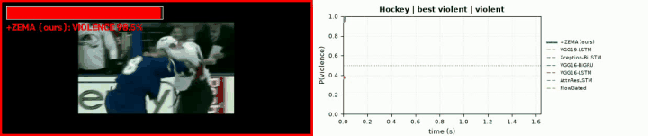<br><sub>best violent · fi112_xvid.avi</sub></td>
<td align="center" width="50%">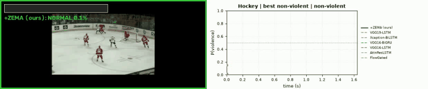<br><sub>best non-violent · no7_xvid.avi</sub></td>
</tr>
<tr>
<td align="center" width="50%">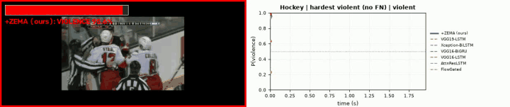<br><sub>hardest violent (no FN) · fi192_xvid.avi</sub></td>
<td align="center" width="50%">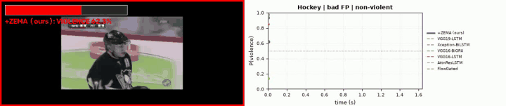<br><sub>bad FP · no269_xvid.avi</sub></td>
</tr>
</table>

#### SURV

| Case | Clip | Truth | ZEMA P(violence) | Comparators wrong |
|:--|:--|:--|--:|--:|
| best violent | [`fi068.mp4`](zema_cases/surv/best_violent_fi068.mp4) | violent | 0.995 | 0/6 |
| best non-violent | [`nofi069.mp4`](zema_cases/surv/best_non_violent_nofi069.mp4) | non-violent | 0.002 | 2/6 |
| bad FN | [`fi078.mp4`](zema_cases/surv/bad_fn_fi078.mp4) | violent | 0.002 | 0/6 |
| bad FP | [`nofi030.mp4`](zema_cases/surv/bad_fp_nofi030.mp4) | non-violent | 0.991 | 6/6 |

<table>
<tr>
<td align="center" width="50%">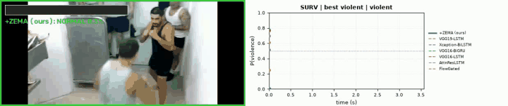<br><sub>best violent · fi068.mp4</sub></td>
<td align="center" width="50%">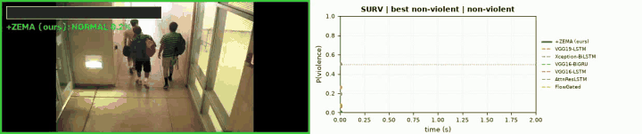<br><sub>best non-violent · nofi069.mp4</sub></td>
</tr>
<tr>
<td align="center" width="50%">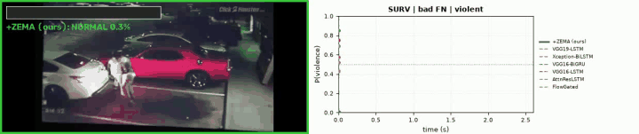<br><sub>bad FN · fi078.mp4</sub></td>
<td align="center" width="50%">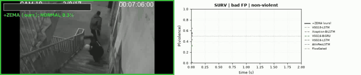<br><sub>bad FP · nofi030.mp4</sub></td>
</tr>
</table>

#### RLVS

| Case | Clip | Truth | ZEMA P(violence) | Comparators wrong |
|:--|:--|:--|--:|--:|
| best violent | [`V_516.mp4`](zema_cases/rlvs/best_violent_V_516.mp4) | violent | 1.000 | 0/6 |
| best non-violent | [`NV_72.mp4`](zema_cases/rlvs/best_non_violent_NV_72.mp4) | non-violent | 0.000 | 0/6 |
| bad FN | [`V_590.mp4`](zema_cases/rlvs/bad_fn_V_590.mp4) | violent | 0.333 | 1/6 |
| bad FP | [`NV_330.mp4`](zema_cases/rlvs/bad_fp_NV_330.mp4) | non-violent | 0.963 | 2/6 |

<table>
<tr>
<td align="center" width="50%">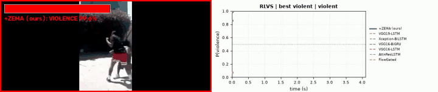<br><sub>best violent · V_516.mp4</sub></td>
<td align="center" width="50%">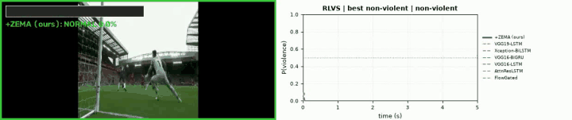<br><sub>best non-violent · NV_72.mp4</sub></td>
</tr>
<tr>
<td align="center" width="50%">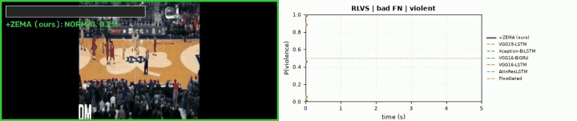<br><sub>bad FN · V_590.mp4</sub></td>
<td align="center" width="50%">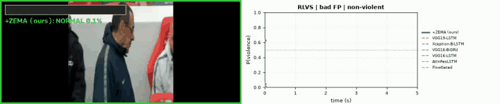<br><sub>bad FP · NV_330.mp4</sub></td>
</tr>
</table>

#### RWF-2000

| Case | Clip | Truth | ZEMA P(violence) | Comparators wrong |
|:--|:--|:--|--:|--:|
| best violent | [`v_RLVS_a_0_1.mp4`](zema_cases/rwf2000/best_violent_v_RLVS_a_0_1.mp4) | violent | 1.000 | 0/6 |
| best non-violent | [`v_BaseballPitch_g04_c02.avi`](zema_cases/rwf2000/best_non_violent_v_BaseballPitch_g04_c02.mp4) | non-violent | 0.000 | 0/6 |
| bad FN | [`v_SUMO_d_1.avi`](zema_cases/rwf2000/bad_fn_v_SUMO_d_1.mp4) | violent | 0.000 | 4/6 |
| bad FP | [`NV_353.mp4`](zema_cases/rwf2000/bad_fp_NV_353.mp4) | non-violent | 1.000 | 2/6 |

<table>
<tr>
<td align="center" width="50%">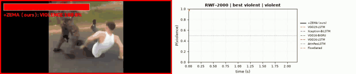<br><sub>best violent · v_RLVS_a_0_1.mp4</sub></td>
<td align="center" width="50%">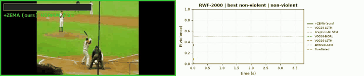<br><sub>best non-violent · v_BaseballPitch_g04_c02.avi</sub></td>
</tr>
<tr>
<td align="center" width="50%">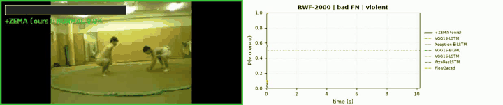<br><sub>bad FN · v_SUMO_d_1.avi</sub></td>
<td align="center" width="50%">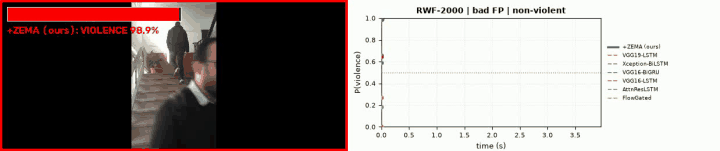<br><sub>bad FP · NV_353.mp4</sub></td>
</tr>
</table>

#### UBI-Fights

| Case | Clip | Truth | ZEMA P(violence) | Comparators wrong |
|:--|:--|:--|--:|--:|
| best violent | [`F_14_0_0_0_0.mp4`](zema_cases/ubi/best_violent_F_14_0_0_0_0.mp4) | violent | 0.989 | 0/6 |
| best non-violent | [`N_530_0_1_1_0.mp4`](zema_cases/ubi/best_non_violent_N_530_0_1_1_0.mp4) | non-violent | 0.000 | 0/6 |
| bad FN | [`F_55_1_0_0_0.mp4`](zema_cases/ubi/bad_fn_F_55_1_0_0_0.mp4) | violent | 0.024 | 3/6 |
| bad FP | [`N_612_1_0_1_0.mp4`](zema_cases/ubi/bad_fp_N_612_1_0_1_0.mp4) | non-violent | 0.963 | 6/6 |

<table>
<tr>
<td align="center" width="50%">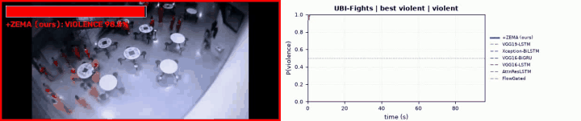<br><sub>best violent · F_14_0_0_0_0.mp4</sub></td>
<td align="center" width="50%">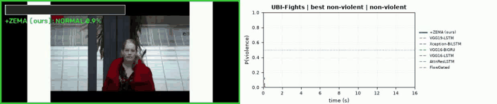<br><sub>best non-violent · N_530_0_1_1_0.mp4</sub></td>
</tr>
<tr>
<td align="center" width="50%">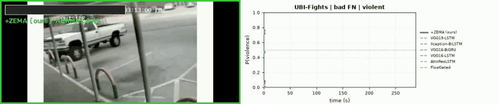<br><sub>bad FN · F_55_1_0_0_0.mp4</sub></td>
<td align="center" width="50%">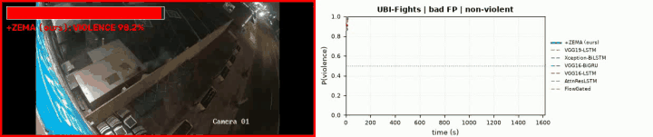<br><sub>bad FP · N_612_1_0_1_0.mp4</sub></td>
</tr>
</table>

Unlike Batch 2 (hand-picked), these clips are selected by the rule above, so the bad cases show the most confident errors, not typical ones. "Comparators wrong" counts how many of the six comparison networks are also on the wrong side of 0.5 for that clip.

---

## 8. Real-time demo (webcam / RTSP / video file)

The real-time demo runs the best fine-tuned **ZEMA + GhostNetV2-ConvLSTM** checkpoint of a chosen
training dataset on a live stream and raises a smoothed alarm.

<p align="center">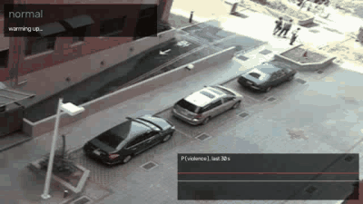</p>

**How it works**
- Every 0.5 s the last few seconds of frames are re-sampled to 16 frames with the
  training reader's rule (truncated linspace, INTER_LINEAR 224x224, BGR→RGB), passed through ZEMA with that
  dataset's config, then through the network. Default window = median test-clip length of the training
  dataset (Hockey 1.6 s, SURV 2 s, RWF-2000 3 s, RLVS 5 s). On a whole clip the output equals the
  showcase/eval pipeline (checked: Hockey `fi88`, 0.9997 vs 0.9997).
- Alarm = k-of-n with hysteresis: ON when ≥ k of the last n probabilities are ≥ 0.6 (3 of the last 5);
  OFF when all of the last 5 are < 0.4.
- Overlay: state, P(violence), latency and a 30 s probability trace; red border while the alarm is on.
- Logs: `windows.csv` (every prediction), `events.csv` (start/end/peak of each alarm), `alert_NNN.mp4`
  (each alarm with pre-roll, ≤ 30 s), and the annotated stream.

**Example run** (`realtime/realtime_zema_surv.mp4`, logs in `realtime/`): a 22 s stream of 11
SURV clips joined back to back (non-violent / 2 fights / non-violent / 2 fights / non-violent), SURV weights,
RTX 5060 Ti, ≈115 ms per prediction including ZEMA preprocessing. The first fight segment (5.4–8.7 s) raised one
alarm at 6.7 s; the second (14.8–20.1 s) produced only isolated peaks (0.66, 0.98) that did not reach 3 of 5,
so no alarm. This is a functional demo, not an accuracy measurement - some of these clips may belong to ZEMA's
SURV training split.

**Before real deployment:** the thresholds and k-of-n are uncalibrated defaults. Fine-tune and set them on
footage from the target cameras (target false alarms per camera per day, then read recall), keep a human in
the loop to confirm alarms, and follow local privacy law (e.g. PDPA) for retention and access.

---

## 9. Usage

**File format**

- Container/codec: `.mp4` (MPEG-4 Part 2), 10 fps, 1238×260; clips run
  ~6.5–37 s (~0.3–1.7 MB each).
- The GIF is 808×195, ~10.6 s, ~7.5 MB.
- Plays in any standard viewer (VLC, browser, QuickTime) with no extra codecs.

**How to use them**

1. **Watch them.** Each clip is self-explanatory: border color and the
   `+ZEMA (ours)` label give the prediction; the right-hand plot shows how ZEMA
   and each baseline evolve over the clip. Look for cases where ZEMA and the
   baselines *disagree* — those illustrate the contribution of the ZEMA
   front-end.

2. **Embed in docs / slides.** The GIF is a ready-made animated summary for a
   README header or a talk. Example Markdown:

   ```markdown
   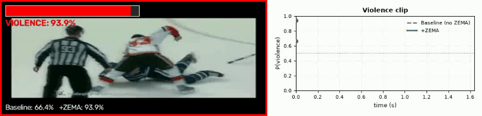
   ```

3. **Extract a still** (e.g. for a figure) with ffmpeg:

   ```bash
   ffmpeg -i violence_V_983.mp4 -vf "select=eq(n\,40)" -vframes 1 frame.png
   ```

> **Note:** these are rendered demo outputs, so they **cannot be fed back into
> the model as inputs** — the overlays and probability plot are part of the
> pixels. To run your own inference or reproduce metrics, obtain the original
> benchmark videos from their source datasets (below) and pass raw frames
> through the ZEMA-Net pipeline.

---

## Acknowledgement: AI assistance

Sections 7 and 8 of this README, the Batch 6 clips in `zema_cases/`, the real-time demo example in `realtime/` and their upload to this repository were prepared with the assistance of **Claude** (Anthropic), using Claude Code: selecting the clips by the stated rule, rendering the videos, writing the section text and committing/pushing the files (commits co-authored by Claude). The model, its training and evaluation, and all research decisions are the authors' own; the authors reviewed the material before publication.

## Attribution

The underlying footage is derived from public violence-detection benchmarks.
Please cite the original datasets if you use these clips:

- **Hockey Fight** — E. B. Nievas, O. D. Suarez, G. B. Garcia, R. Sukthankar,
  *"Hockey Fight Detection Dataset,"* CAIP, 2011.
- **RLVS (Real-Life Violence Situations)** — M. M. Soliman *et al.,*
  *"Violence Recognition from Videos Using Deep Learning Techniques,"* ICICIS, 2019.
- **SURV (Surveillance Camera Fight)** — Ş. Aktı, G. A. Tataroğlu, H. K. Ekenel,
  *"Vision-based Fight Detection from Surveillance Cameras,"* IPTA, 2019.
- **RWF-2000** — M. Cheng, K. Cai, M. Li, *"RWF-2000: An Open Large Scale Video Database for Violence
  Detection,"* ICPR, 2020.
- **UBI-Fights** — B. Degardin, H. Proença, *"Iterative Weak/Self-Supervised Classification Framework for
  Abnormal Events Detection,"* Pattern Recognition Letters, 2021.

## Citation

> The ZEMA-Net manuscript is under review. Replace this block with the final
> reference once published.

```bibtex
@unpublished{wareechol_zema_net,
  author = {Wareechol, Tanapat and Chiracharit, Werapon},
  title  = {Temporal--Spatial Modeling for Violence Detection in Videos with Dynamic Camera Motion},
  note   = {Manuscript under review},
  year   = {2026}
}
```

## License

> _TODO: add a license (e.g. for the code/demos). Note that redistribution of
> the sample footage may be subject to the terms of the original datasets._
